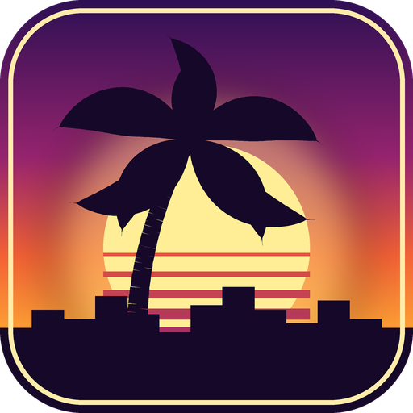

<p align="center"></p>

# openSA

An open-source reimplementation of the **GTA San Andreas** runtime, written in C++ on top of
[librw](https://github.com/aap/librw) and checked against the 1.0 US executable you already own.

> **No game files are included and none are needed in this repository.** You need your own copy of
> GTA San Andreas (the viewers only read its `data/` and `models/` folders). This project is not affiliated
> with Rockstar Games or Take-Two Interactive.

Website: <https://lakomoor.github.io/openSA/>

## Status

Early stage. This is a data and streaming layer plus viewers, not a playable game.

| Area | State |
|---|---|
| IMG v2, `gta.dat`/`default.dat`, all IDE sections, text + binary IPL, DFF/TXD loading | done; the whole stock game parses without errors |
| Streaming slot layout (`CStreaming::LoadCdDirectory`), pool sizes (`CPools::Initialise`), TXD slots | done, taken from the decompiled executable |
| Streamer (request / load / remove, model → TXD → parent TXD chain) | done (synchronous, no loading channels or memory budget yet) |
| `sa_stream`: whole-map viewer that streams models and textures around a free camera, with LOD | done; distance/LOD rule follows `SetupMapEntityVisibility` (colModel radius from COL headers; no occlusion, tunnels or fade yet) |
| Vehicles: palette paint, wheels | partial: stock wheel per car and right-wheel orientation unverified |
| Real `CRenderer` visibility/LOD rules | distance part done; culling pending; big-building rule from `CFileLoader`; LOD multiplier follows `CCamera::Process` and the rendering FOV (`SA_FOV`, default 70; during cutscenes the original uses 1.0, not applicable here) |
| Time of day: `timecyc.dat` parsed, sky colour, fog, far clip and ambient follow `SA_HOUR` / `SA_WEATHER` (day/night vertex colours from the Extra Vert Colour plugin, balance curve verified in the exe; game clock runs 1 minute per second (`SA_CLOCK=0` freezes it); hourly weather changes follow the exe forecast tables and blend the timecyc keys; sky follows CClouds::RenderSkyPolys (banded gradient 0.5 / 0 / -0.1 / -0.3 of a 30 m wall, below-horizon grey table from the exe) with a additive coronastar sun sprite (particle.txd) at the exe's vector-to-sun and the directional light follows it, low clouds (12 additive cloud1 sprites after CClouds::Render_RenderLowClouds), moon disc (no crescent mask) and Rockstar logo (layout unverified), rain streaks (CWeather::RenderRainStreaks: 32 lines, Rain step from the exe; wind taken as 0, no particles/puddles/wet roads; streaks confirmed drawn on screen with SA_RAINDEBUG=1 red test colour); no rainbow, fog banks, sandstorm or lightning; water.dat polygons drawn as two textured layers (waterclear256, UV scale 25 / 12.5 m, alpha 160 / 90 from the exe, colour = raw timecyc water rgb, layer alphas derived from the timecyc alpha as the exe does; UV scroll follows the nearest flow (layer-1 sin/cos term missing); no waves, foam or flow shading, and the result still looks darker than the original); CJ treads water at waterLevel-0.55 with swim_tread, entry rule derived from CPed::ProcessBuoyancy (origin < waterLevel-0.6; swim-task exit and clip blending approximated)) | partial |
| Collision: COL2/3/4 geometry parsed (1.06 M triangles in gta3.img); walk mode (`G`): ground via vertical ray tests, walls via the exe's three ped spheres, third-person camera (look-at height 0.6 m from the exe table at 0x8CC548; follow distance 4 m is assumed, the exe gives min(2.0 + zoom, 4.0) with the default zoom unresolved) with a COL ray test (ray cast checked against ground and forward hits; objects without COL do not block it), CJ (base body parts from player.img, no clothes) animated from `ped.ifp` (idle/walk/run clips switched by key, no blending; `SA_MALE01=1` selects the generic male01 ped) | partial |
| Vehicle reflections, vehicle and ped physics, peds, traffic, scripts, audio | not started |

The goal is behaviour identical to the original game. Facts read from the executable are marked as such in
the source comments (function names and addresses refer to the 1.0 US executable); everything else is an
assumption and is called out as one.

## Build (Windows, Visual Studio 2022, CMake 3.15+)

```bat
git clone https://github.com/LakoMoor/openSA
cd openSA
git clone https://github.com/aap/librw third_party/librw

cmake -S sa_view -B build/view
cmake --build build/view --config Release --target sa_stream sa_world sa_view

build\view\Release\sa_stream.exe "C:\Games\GTA San Andreas" 2495 -1690
```

Controls: `G` toggles walk mode (gravity, ground collision), `W A S D` move (run; `Left Alt` walks, `Space` sprints, `Left Shift` jumps; speeds from the ped.ifp root motion, jump from CTaskSimpleJump::Launch), `Q`/`E` down/up, `Shift` faster, left mouse drag to look, `Esc` quits.
`sa_world.exe <gamedir> [x y radius]` shows a static slice of the map, `sa_view.exe <gamedir> [model]` shows one
model (try `infernus`, `cheetah`, `banshee`).

Data-layer tools (no GPU needed):

```bat
cmake -S sa_port -B build/port
cmake --build build/port --config Release
build\port\Release\load_all.exe "C:\Games\GTA San Andreas"   :: parse every IDE/IPL, report problems
build\port\Release\stream_info.exe "C:\Games\GTA San Andreas" :: slot assignment + streamer self-test
```

## Layout

| Path | Contents |
|---|---|
| `sa_port/src` | data library: archives, IDE/IPL, RenderWare chunk walker, streaming slots, streamer |
| `sa_view` | librw (D3D9) viewers: `sa_view`, `sa_world`, `sa_stream` |
| `tools` | helpers for mapping function addresses to names from the public gta-reversed project |
| `branding` | logo and icon (original artwork) and the script that draws them |
| `docs` | project website (GitHub Pages) |

## Licence

Source code: MIT, see `LICENSE`. librw is a separate project (MIT) and is not part of this repository.
"Grand Theft Auto" and "San Andreas" are trademarks of their respective owners.
